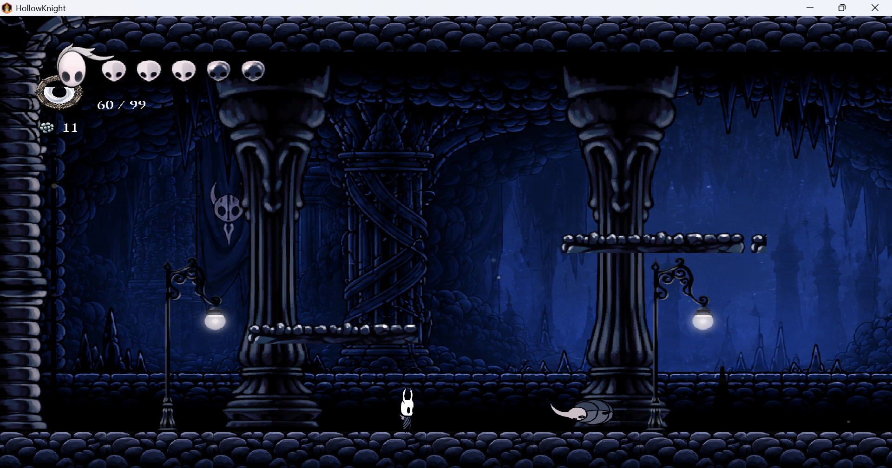
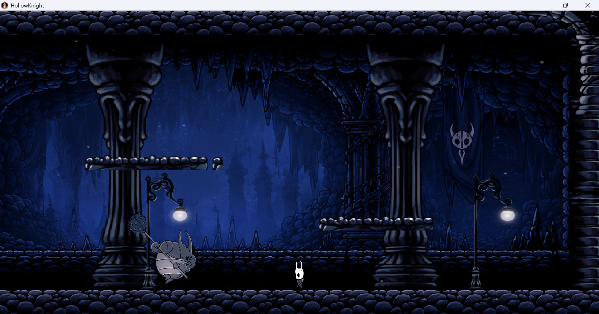
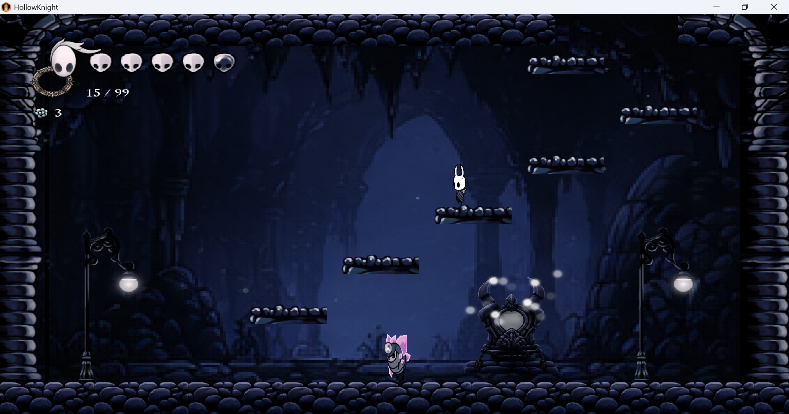

# Hollow Knight – 2D Game Simulation

A 2D game simulation inspired by **Hollow Knight**, developed in Java using the **LibGDX** framework.

This project recreates parts of the Hollow Knight experience, featuring custom game environments, player interactions, combat encounters, and a game interface inspired by the original game.

## 🎮 Screenshots

Here are some screenshots from the game:

### Main Menu


### Boss Room


### Boss Fight


### Secret Room


## 🎮 Gameplay Demo

Watch the gameplay videos:

- [▶ Gameplay Video](screenshots/gameplay-gif.mp4)
- [⚔️ Boss Fight](screenshots/boss-fight.mp4)
- [🗺️ Game Exploration](screenshots/game-paly.mp4)
- 
## ✨ Features

- 2D gameplay inspired by Hollow Knight
- Custom-designed game environments
- Player movement and combat mechanics
- Boss encounter and exploration areas
- Inventory and charm management system
- Save and load functionality
- Settings and user interface

## 🛠️ Built With

- **Java** – Main programming language
- **LibGDX** – Game development framework
- **Gradle** – Build automation

## 📁 Project Structure

| Directory | Description |
|---|---|
| `core/` | Main game logic and functionality |
| `assets/` | Sprites, textures, and audio resources |
| `lwjgl3/` | Desktop launcher |
| `saves/` | Game save files |
| `screenshots/` | Screenshots and gameplay video |

## 🚀 Getting Started

### Prerequisites

- Java JDK
- IntelliJ IDEA (recommended)

### Installation

1. Clone the repository:

   ```bash
   git clone https://github.com/GOLI-2007/HollowKnight.git
   ```

2. Open the project in IntelliJ IDEA.

3. Allow Gradle to sync the project.

4. Run the desktop launcher.

   On Windows, you can also use:

   ```bash
   gradlew.bat lwjgl3:run
   ```

## 👩‍💻 About

This project was developed as a Java game development project, inspired by the world and gameplay of Hollow Knight.

---

*This is an independent fan-made project and is not affiliated with Team Cherry.*
