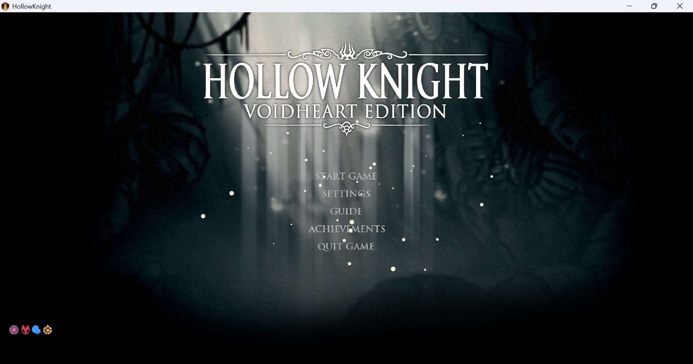

# Hollow Knight – 2D Game Simulation

A 2D game project inspired by **Hollow Knight**, developed using Java and the LibGDX framework.

This project recreates elements of the original Hollow Knight experience, focusing on game mechanics, player interactions, visual design, and user interface.

## 🎮 Gameplay

Here are some screenshots from the game:




## 🎥 Gameplay Demo

Watch a short gameplay preview:


[Watch Full Gameplay Video](screenshots/gameplay.mp4)

## ✨ Features

- 2D gameplay inspired by Hollow Knight
- Player movement and game interactions
- Inventory system
- Charm selection and equipment system
- Save and load functionality
- Settings menu with different configuration options
- Custom game UI and visual elements

## 🛠️ Technologies

- **Programming Language:** Java
- **Game Framework:** LibGDX
- **Build System:** Gradle
- **IDE:** IntelliJ IDEA

## 📂 Project Structure

- `core/` – Main game logic and functionality
- `assets/` – Game resources, sprites, textures, and audio
- `lwjgl3/` – Desktop launcher
- `saves/` – Game save files
- `screenshots/` – Project screenshots and gameplay previews

## 🚀 How to Run

1. Clone the repository:

   ```bash
   git clone YOUR_GITHUB_REPOSITORY_URL
   ```

2. Open the project in IntelliJ IDEA.

3. Wait for Gradle to finish syncing.

4. Run the desktop launcher.

   Alternatively, on Windows, use:

   ```bash
   gradlew.bat lwjgl3:run
   ```

## 👩‍💻 Developer

Developed as a Java game development project.

---

*This is an independent fan-inspired project and is not affiliated with Team Cherry.*
